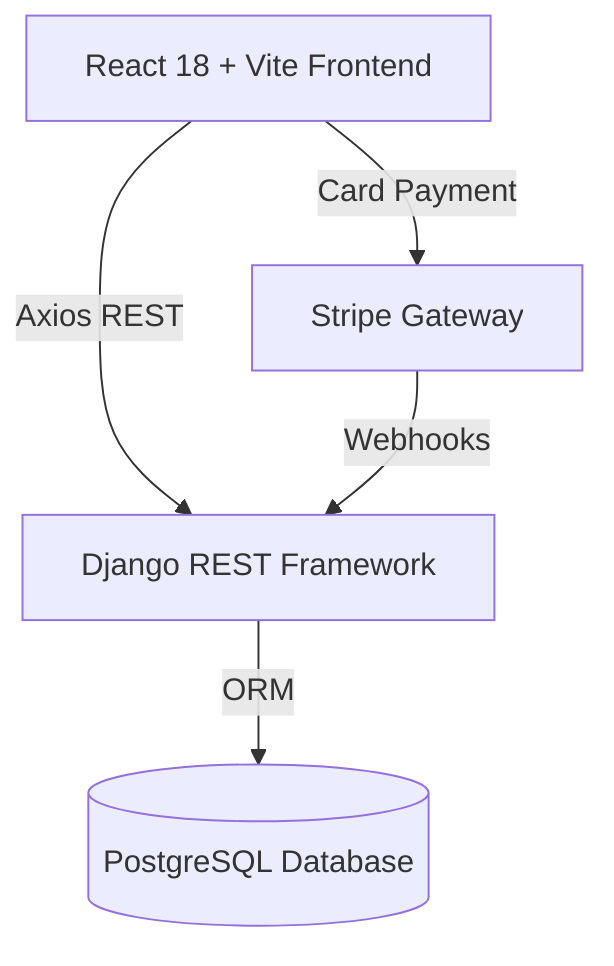

# 🚘 DriveFlow — Full-Stack Car Rental & Dealership Platform

<div align="center">

[](https://react.dev/)
[](https://www.django-rest-framework.org/)
[](https://stripe.com)
[](https://www.postgresql.org/)

<p align="center">
  <b>A comprehensive car rental and dealership SaaS platform.</b><br>
  Built with React + Vite on the frontend and Django REST Framework on the backend, featuring Stripe checkout, dynamic pricing, and an intuitive fleet management dashboard.
</p>

</div>

---

## 🎯 Platform Highlights

### 🛒 Customer Experience
- **Interactive Fleet Catalog**: Filter by brand, transmission, fuel type, daily rate, and seating capacity.
- **Dual Booking Modes**: Rent daily/weekly or buy certified pre-owned vehicles.
- **Seamless Checkout**: Secure payment processing with Stripe Elements.
- **Reservation Tracking**: Instant PDF invoices and live booking status updates.

### 💼 Admin Operations
- **Fleet Management**: Add, update, and track vehicle maintenance status.
- **Booking Calendar**: Visual availability timeline preventing double bookings.
- **Financial Analytics**: Revenue breakdowns, rental duration stats, and customer metrics.

---

## 🏗️ Architecture



---

## 🚀 Setup & Installation

### 1. Backend (Django REST)
```bash
cd BackendRental
python -m venv venv
source venv/bin/activate
pip install -r requirements.txt
python manage.py migrate
python manage.py runserver
```

### 2. Frontend (React + Vite)
```bash
cd FrontendRental
npm install
npm run dev
```

Navigate to `http://localhost:5173`.

---

## 👨‍💻 Author

**Omar Torbi** — Full-Stack Engineer & Software Architect
- 🌐 **Portfolio**: [omartorbi.engineer](https://www.omartorbi.engineer)
- 💼 **LinkedIn**: [linkedin.com/in/omar-torbi](https://www.linkedin.com/in/omar-torbi-b8340933a/)
- 🐙 **GitHub**: [@TORBIomar](https://github.com/TORBIomar)
- ✉️ **Email**: [torbi.dev@outlook.com](mailto:torbi.dev@outlook.com)
